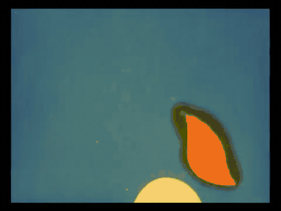

<p align="center"></p>

<h1 align="center">Lightplay</h1>

<p align="center">
<b>글자와 도형을 움직이고, 음악과 같은 시간 위에 놓는다.</b><br>
코드로 만드는 한국어 모션그래픽. 콘셉트부터 렌더, 비평, 수정, 납품까지.<br>
Claude Code와 Codex에서 쓰는 모션그래픽 제작 하네스.
</p>

<p align="center">


</p>

<p align="center"><a href="#무엇을-만드는가">소개</a> · <a href="#왜-lightplay인가">이름의 이야기</a> · <a href="#설치">설치</a> · <a href="#만들고-고치는-법">사용법</a> · <a href="#op55와-함께">OP55와 함께</a> · <a href="#thanks-to-showreel">Thanks to Showreel</a> · <a href="docs/guide/README.md">가이드</a></p>

---

## 무엇을 만드는가

- **모션그래픽.** 한글 타이포그래피, 도형, 데이터, 이미지가 움직이는 쇼릴·제품 소개·행사 홍보·교육 영상.
- **하나의 콘셉트.** 정해진 템플릿에 내용을 끼우지 않고, 주제에서 표현 방식을 고른다. 구간별 움직임과 화면의 밀도도 그 콘셉트에서 정한다.
- **다시 고칠 수 있는 프로젝트.** MP4와 함께 원고, 타임라인, 장면 코드, 오디오 원본, 검수 기록을 남긴다.

실사 촬영본의 컷 편집이나 Sora·Veo 같은 생성형 비디오 모델 호출은 이 하네스의 범위가 아니다. 이미지 생성은 장면에 필요한 재료를 만드는 데 쓴다.

## 왜 Lightplay인가

**빛과 도형의 움직임에도 악보가 있다.**

1921년, 발터 루트만(Walter Ruttmann)은 색과 도형이 움직이는 추상 영화 *Lichtspiel Opus I*를 선보였다. *Lichtspiel*은 빛의 유희, 영어로는 *Lightplay*. 이 이름은 그 작품에서 가져왔다. [퐁피두 센터의 작품 기록](https://www.centrepompidou.fr/fr/ressources/oeuvre/cdLrro)

<p align="center"></p>

이름에 영감을 준 Walter Ruttmann의 《Lichtspiel Opus I》(1921), 05:30–05:36. [Wikimedia Commons](https://commons.wikimedia.org/wiki/File:Lichtspiel_Opus_I_(1921).webm) · Public domain · [출처](THIRD_PARTY.md#lichtspiel-opus-i-film-excerpt)

화면만의 작품은 아니었다. 작곡가 막스 부팅(Max Butting)이 음악을 맡았다. [구겐하임의 상영 프로그램](https://www.guggenheim.org/wp-content/uploads/2017/08/guggenheim-film-visionaries-program.pdf)은 루트만이 부팅에게 현악 사중주 악보를 의뢰하고, 화면과 음악의 타이밍을 맞추기 위한 표기를 악보에 더했다고 설명한다.

Lightplay는 이 협업에서 영감을 받았다. 오늘의 악보는 코드와 타임라인이다. 글자와 도형이 움직이는 순간, 음악의 강세가 닿는 순간을 같은 시간 위에서 설계한다.

## 설치

고정된 [`skills@1.7.4` 설치 도구](https://github.com/vercel-labs/skills/blob/v1.7.4/package.json)는 Node.js ≥ 22.20.0을 요구한다. 이는 설치 도구의 요구 사항이며, 영상·음악 제작에 필요한 개별 도구와 자산은 별도로 확인한다.

개별 스킬이 공통 도구와 자료를 함께 사용하므로, 한 프로젝트에 전체 스킬을 설치한다.

```bash
npx skills@1.7.4 add ynginkim/lightplay -a claude-code -a codex
```

<details>
<summary>음악 경로·기존 설치본·환경 확인</summary>

기본 음악 경로인 op55를 쓸 때는 같은 프로젝트에 `npx skills@1.7.4 add ynginkim/op55 -a claude-code -a codex`로 설치한다. op55 경로를 직접 제공할 수도 있다. 지원 기준은 op55 0.2.0 이상과 resolve-op55-tools 구조다. [v0.2.0 릴리스](https://github.com/ynginkim/op55/releases/tag/v0.2.0)가 발행되어 있다. 버전 정보가 없는 기존 resolve-op55-tools 설치본은 실제 경로와 "버전 미확인"을 기록하고 산출물로 호환성을 확인한다. 옛 op55/scripts 배치는 새 설치 후 `npx skills@1.7.4 remove op55`로 정리한다. 전역 사본이면 `-g`를 붙인다. ElevenLabs Music은 TTS용 키가 있어도 Music 권한·크레딧을 별도로 확인한다. API를 쓰지 않으면 내장 합성으로 진행할 수 있다.

설치본은 복사본이다. 이 저장소가 바뀌면 다시 설치한다. 렌더러 의존성(playwright-core)은 첫 `new_project.py` 실행 때 설치본의 scripts 폴더 안에 받는다. 비공개 저장소이므로 설치하는 계정에 읽기 권한이 있어야 한다. 로컬 경로 설치 smoke는 통과했으며, GitHub 경로 설치는 아직 별도 검증하지 않았다.

</details>

## 만들고 고치는 법

영상 작업 폴더에서 자연어로 요청한다. `showreel-mode`로 시작한다.

### 처음 만들 때

> 다음 달 밋업을 소개하는 15초 세로 모션그래픽을 만들어 줘. 한글 타이포그래피가 중심이고, 마지막 음악 강세에 행사명이 나타나면 좋겠어. 일시·장소·신청 링크는 이 자료를 써 줘.

대상과 꼭 넣을 정보, 자료 위치를 확인한 뒤 콘셉트·원고·오디오·장면을 만든다. 초안을 렌더하고 약한 구간을 비평해 다시 만든 후 최종 믹스와 검수를 거친다.

```text
요청 → 콘셉트·원고 → 음악·나레이션·큐 → 장면 코드 → 초안 렌더
                                                    ↓
                    납품 ← 최종 렌더·믹스 ← 비평·재작업
```

### 만든 것을 고칠 때

> 마지막 문구만 바꾸고, 나레이션 울림을 줄여 줘. 음악과 전체 길이는 그대로 유지해 줘.

수정 요청은 별도 playbook으로 처리한다. 무엇이 바뀌는지 먼저 찾고, 그 값에 의존하는 결과만 다시 만든다. 화면이 읽는 큐·음악 에너지·규격이 달라지면 해당 장면을 다시 렌더한다. 음색이나 볼륨처럼 화면에 영향을 주지 않는 수정은 믹스와 마감에서 처리한다.

### 남는 것

| 결과 | 용도 |
| --- | --- |
| 마스터 MP4 · 공유용 MP4 · 포스터 JPG | 완성 영상과 배포용 파일 |
| 자막 SRT | 나레이션이 있는 영상의 자막 |
| 원고 · 타임라인 · 장면 코드 · 오디오 원본 | 수정하고 다시 렌더할 근거 |
| 비평 기록 · 검수 시트 · 수치 보고 | 무엇을 확인했고 무엇을 고쳤는지 |
| 제작노트 | 출처·크레딧·재생성 명령·남은 사람 확인 |

## 세 가지 제작 원칙

| 원칙 | 실제로 하는 일 |
| --- | --- |
| **콘셉트가 먼저** | 주제에서 표현 방식을 찾는다. 도구 목록이나 익숙한 템플릿부터 고르지 않는다. |
| **렌더한 증거로 판정** | 프레임·검수 시트·수치를 보고 약한 구간을 고친다. 실행 성공을 영상 품질로 대신하지 않는다. |
| **큐는 고정, 표면은 늦게** | 화면과 소리를 이름 붙은 큐에 연결한다. 수정할 때는 화면이 소비하는 값이 바뀌었는지부터 확인한다. |

원칙은 각각 [콘셉트](skills/principle-concept-before-template/SKILL.md), [렌더 증거](skills/principle-judge-rendered-evidence/SKILL.md), [큐와 수정 범위](skills/principle-stable-cues-late-surfaces/SKILL.md)에 적혀 있다.

## OP55와 함께

**OP55는 음악을 작곡하고, Lightplay는 그 음악 위에 움직임을 설계한다.**

[OP55](https://github.com/ynginkim/op55)의 이름은 *Opus 5.5 → Op. 55*, 베토벤의 교향곡 3번으로 이어진다. Lightplay의 이름은 루트만과 부팅의 *Lichtspiel Opus I*에서 왔다.

- **음악을 부탁한다.** Lightplay가 영상 길이, 구간별 에너지와 강세, 나레이션 사이의 빈틈을 정하면 OP55가 악보를 코드로 쓰고 음악을 렌더·검수한다.
- **같은 시간을 쓴다.** 음악 파일과 박·다운비트·히트 정보를 받아 타임라인을 만들고, 글자와 도형이 등장하고 멈추는 순간을 큐에 연결한다.
- **고칠 곳을 나눈다.** OP55는 작곡과 음악 렌더를, Lightplay는 장면·나레이션·효과음·최종 믹스를 맡는다. 바뀐 값이 화면에 영향을 주는지 확인한 뒤 재렌더 범위를 정한다.

연동 형식은 [음악 파일 계약](skills/prepare-video-audio/references/music.md)과 [공유 타임라인](skills/resolve-showreel-tools/references/contract.md)에서 확인할 수 있다.

## 구성

<!-- skillset:summary:start -->
mode 1개, playbook 2개, skill 6개, principle 3개 (설치 단위 10개).

검사: `python3 scripts/check.py .`
<!-- skillset:summary:end -->

| 종류 | 이름 | 하는 일 |
| --- | --- | --- |
| mode | `showreel-mode` | 자연어로 진입한다. 요청과 프로젝트 상태를 보고 playbook을 고르고 결과물·완료·사람 판정을 맡는다 |
| playbook | `create-video`, `revise-video` | 새 영상 만들기, 만든 영상 고치기(무효화 범위와 재사용 판단) |
| adapter | `resolve-showreel-tools` | 스크립트·엔진 자원을 한 벌 소유하고 `S`·`O` 경로, 환경 점검, 새 프로젝트, 옛 프로젝트 복원을 맡는다 |
| skill | `plan-video`, `prepare-video-audio`, `build-video-scenes`, `critique-video`, `deliver-video` | 기획·원고, 음악·나레이션·효과음·타임라인, 이미지·장면, 초안 비평, 최종 렌더·믹스·마감·납품 |
| principle | `principle-concept-before-template`, `principle-judge-rendered-evidence`, `principle-stable-cues-late-surfaces` | 콘셉트가 먼저, 렌더한 증거로 판정, 큐는 고정하고 표면은 늦게 |

## 사용 전 확인

- 영상·음악의 최종 품질은 사람이 전체를 보고 들어 확인한다. 구조 검사나 렌더 성공만으로 납품 품질을 판정하지 않는다.
- 한국어 타이포그래피와 나레이션을 중심으로 설계했다. 다른 언어는 별도 검수가 필요하다.
- 외부 API는 해당 계정의 권한·크레딧·사용 조건을 확인한다. 폰트·이미지·음악에도 개별 이용 조건이 적용된다.

구조·회귀·설치 검사 기록은 [검증 문서](docs/validation.md), 실행별 CI 결과는 해당 커밋이나 PR에서 확인한다. 실제 제작에 사용할 환경과 자산은 작업마다 점검한다.

## 더 알아보기

[사용 가이드](docs/guide/README.md) · [설계](DESIGN.md) · [이식 기록](docs/migration.md) · [음악 경로와 BYOK](skills/prepare-video-audio/references/music.md)

## Thanks to Showreel

**Lightplay의 출발점은 [Minho Hwang(revfactory)의 Showreel](https://github.com/revfactory/showreel)이다.**

코드로 모션그래픽을 만든다는 아이디어만 가져온 것이 아니다. 콘셉트를 세우고, 원고와 오디오를 먼저 맞추고, 장면을 렌더한 뒤 약한 구간을 다시 만드는 제작 흐름부터 엔진·스크립트·레퍼런스까지, Showreel이 열어 둔 작업 위에서 시작했다.

특히 고마운 것은 **도구와 함께 만드는 기준까지 공개했다는 점**이다. 결과물이 움직이는 데서 멈추지 않고, 왜 이 콘셉트인지, 어느 장면이 약한지, 무엇을 다시 만들어야 하는지 묻게 했다. 덕분에 출발선부터 다시 만들지 않고 그 위에서 다음 질문을 이어 갈 수 있었다.

Lightplay는 이 기반을 mode·playbook·skill·principle로 나누고, OP55와의 음악 연결과 수정 범위 판단을 더해 발전시키고 있다. 이름이 바뀌어도 어디서 시작했는지는 남긴다. 좋은 작업 방식을 다른 사람이 이어받을 수 있도록 MIT로 공개해 준 Minho Hwang과 Showreel에 감사한다.

[Showreel 살펴보기](https://github.com/revfactory/showreel) · [이식 과정](docs/migration.md) · [원 저작권 고지](LICENSE)

## 출처와 라이선스

- **코드와 제작 지침.** [revfactory/showreel](https://github.com/revfactory/showreel)과 [ynginkim/showreel의 기준 커밋](https://github.com/ynginkim/showreel/tree/307b3fd8407feca15c7bd74a089276e8002b204c)에서 시작했다. 원 저작권과 MIT 허가문은 [LICENSE](LICENSE)와 [adapter의 LICENSE](skills/resolve-showreel-tools/LICENSE)에 보존한다.
- **이름의 영감.** Walter Ruttmann, *Lichtspiel Opus I* (1921), 음악 Max Butting. 위 작품·상영 기록은 이름과 제작 철학의 출처다.
- **대표 그림.** README 배너는 이미지 생성 도구로 만든 창작 이미지다. 본문의 원작 영상과 구분되며, Lightplay의 영상 출력 예시는 아니다.
- **외부 자산.** 패키지, API 서비스, 음악, 프로젝트별 폰트·이미지의 조건은 [THIRD_PARTY.md](THIRD_PARTY.md)에서 구분한다. 이 저장소의 MIT 라이선스가 외부 자산까지 다시 허가하지는 않는다.

## 기여와 버전

[기여 안내](CONTRIBUTING.md) · [행동강령](CODE_OF_CONDUCT.md) · [보안 제보](SECURITY.md) · [도움받기](SUPPORT.md) · [변경 기록](CHANGELOG.md) · [버전·릴리스](RELEASING.md)

소스 버전은 [VERSION](VERSION)에서, 발행된 태그·릴리스는 [GitHub Releases](https://github.com/ynginkim/lightplay/releases)에서 확인한다. 재현 가능한 설치에는 실제 존재하는 태그 또는 전체 40자리 커밋 SHA를 `#REF`로 지정한다. `@name`은 버전이 아니라 skill 선택이다.

[하네스 패밀리](https://github.com/ynginkim/harness-family) 공통 철학과 목록. 비공개 저장소는 접근 권한이 있는 계정에서만 열린다.
